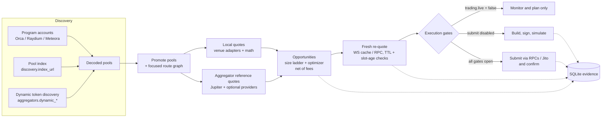

# arb-bot-tokens

A Rust engine that looks for two-leg arbitrage on Solana between Orca, Raydium and Meteora pools, checks each opportunity against a fresh re-quote and full cost model, and builds, signs and simulates atomic transactions. Transaction submission is off by default and stays behind several layers of gates.

> **Status: experimental.** This is a research and engineering project, not a production trading system. It has not shown consistent profitability. Running it with a funded wallet and submission enabled can lose money through fees, slippage and failed transactions.

---

## Contents

- [Overview](#overview)
- [Features](#features)
- [Architecture](#architecture)
- [Safety design](#safety-design)
- [Requirements](#requirements)
- [Build and setup](#build-and-setup)
- [Configuration](#configuration)
- [Usage](#usage)
- [Dashboard and HTTP API](#dashboard-and-http-api)
- [Testing](#testing)
- [Project structure](#project-structure)
- [Status and limitations](#status-and-limitations)
- [License](#license)

## Overview

The same token often trades in several Solana AMM pools at slightly different prices. When the gap between two pools is larger than the combined swap fees, network fees, slippage and setup costs, buying in one pool and selling in the other within a **single atomic transaction** can lock in the difference. If the second leg would return less than the input, the whole transaction fails.

Most opportunities that look profitable on a stale price are gone, or were never real, once you account for current account state and every cost. So the bot treats a cheap price signal as nothing more than a lead. Before anything is signed, the opportunity has to pass:

1. **Discovery.** Find candidate pools for each token from on-chain programs and a pool index, plus optional dynamic token discovery.
2. **Local quoting.** Decode pool accounts (constant-product, CLMM and DLMM) and quote both legs locally.
3. **Sizing and cost model.** Search a ladder of trade sizes to maximise net profit after DEX fees, priority fees, optional Jito tips and token-account (ATA) rent.
4. **Fresh re-quote.** Re-quote the selected route against freshly fetched or WebSocket-streamed account data, enforcing freshness limits.
5. **Execution guards.** Build the two-leg transaction with on-chain minimum-output protection, simulate it, and submit only if every configured gate is open.

The repository also contains an older TypeScript scanner and dashboard from before the Rust migration (see [TypeScript tools](#typescript-tools-legacy)).

## Features

- **Native pool support** through the [`swaps`](https://crates.io/crates/swaps) crate: Orca Whirlpool, Raydium AMM v4 / CLMM / CPMM, and Meteora DLMM / DAMM v2 / Pools.
- **Pool discovery** from program accounts and a DexScreener-compatible pool index (`discovery.index_url`), filtered by liquidity.
- **Dynamic token discovery** with filters for liquidity, organic score, market cap, verification and the number of supported venues (`[aggregators]`).
- **Aggregator reference quotes** from Jupiter (enabled in the shipped profiles). Optional providers are off by default and turned on with environment variables: Raydium Trade API, DFlow, OKX, OpenOcean, SpiderSwap, Titan, Vybe and Venum.
- **Two-pool route-size optimizer** that scores candidate input sizes against a full execution cost model.
- **Focused routes** (`execution.native_focus_routes`) that pin specific buy/sell venue pairs and can require fresh account data before quoting.
- **WebSocket account cache**: subscribes to hot pool accounts within a configurable budget and triggers reactive re-quotes when they change.
- **Dynamic fee engine**: priority fee taken from a percentile of recent fees and capped, plus optional Jito tip and ATA rent accounting.
- **SQLite evidence store** (`rusqlite`, bundled): tokens, pools, route families and edges, account manifests, quote observations, simulation results, execution attempts, live settlements and route cooldowns.
- **Offline analysis**: `db-summary` reports route status, and `quote-replay` re-runs recorded optimizer decisions and measures quote drift.
- **Built-in dashboard and JSON API** (axum) with pause, resume and emergency-stop controls.

## Architecture



Each **scan cycle** (`BotEngine::run_cycle`) runs on `trading.scan_interval_ms`, and runs early when a WebSocket update arrives for a focused route:

1. Refresh the SOL/USD estimate and the network fee estimate.
2. Re-run discovery if `discovery.refresh_interval_ms` has elapsed. Otherwise reuse the cached pool set.
3. Promote pools, add pools from the persisted focused-route graph, and compute local quotes and aggregator reference quotes.
4. Rank opportunities by net USD profit, then select execution candidates. Candidates on focused routes are re-quoted against fresh account data.
5. Run execution gating (see [Safety design](#safety-design)). For each surviving candidate, the executor builds a native two-leg transaction (or an API-routed one for aggregator venues), simulates it, and submits only if allowed.
6. Publish a state snapshot to the dashboard and record evidence in SQLite.

### Rust modules (`crates/arb-bot/src`)

| Module | Responsibility |
| --- | --- |
| `main.rs` | CLI (clap) entry point and subcommands |
| `config.rs` | TOML config schema, environment-variable defaults, `env:` reference resolution |
| `engine.rs` | Scan loop, discovery, candidate selection, fresh re-quotes, execution gating, state snapshot |
| `venues/` | `VenueAdapter` trait and Orca, Raydium and Meteora pool decoders |
| `math.rs` | Constant-product and price-based quoting, two-pool route-size optimizer, quote drift and replay |
| `fees.rs` | Dynamic priority fee, Jito tip and ATA rent cost model |
| `pool_index.rs` | Pool index client used for discovery |
| `pool_subscription.rs` | WebSocket account subscriptions, hot account cache, focused-route readiness |
| `aggregators.rs` | Aggregator quote manager, provider pacing, dynamic token discovery |
| `native_swap.rs` | Builds native two-leg swap instructions with min-out protection |
| `api_swap.rs` | Builds transactions for aggregator-API routed legs |
| `live_swap.rs` | Executor: re-quote, sign, simulate, submit, confirm. Also smoke-test commands |
| `executor.rs` | Simple transaction plan used by `dry-run` |
| `rpc.rs` | JSON-RPC client |
| `sol_price.rs` | SOL/USD estimate from a Jupiter quote, with fallback |
| `db.rs` | SQLite schema, migrations, route graph, evidence and reporting queries |
| `dashboard.rs` | axum HTTP server, JSON endpoints and HTML dashboard |
| `env_runtime.rs` | `.env` loading with throttled live refresh |
| `rwa.rs` | Real-world-asset (tokenized equity) scanner. Disabled in the shipped profiles (see [limitations](#status-and-limitations)) |
| `types.rs` | Shared types, mint and program constants |

## Safety design

Live submission needs **several independent switches** to be on together. The shipped profiles leave submission off.

### Execution levels

| `trading.live` | `execution.enabled` | `execution.submit_enabled` | Behaviour |
| --- | --- | --- | --- |
| `false` | any | any | Monitor and plan only. No wallet needed for scanning. |
| `true` | `false` | any | Scan only. Execution is reported as disabled. |
| `true` | `true` | `false` | Candidates are re-quoted, built, **signed and simulated**, never submitted. This is what `config.tokens.toml` ships with (`execution_profile = "token_probe_no_submit"`, a descriptive label). |
| `true` | `true` | `true` | Submission is possible, but only once the arming and risk gates below pass. |

### Submit arming gates (engine)

With `submit_enabled = true`, the engine refuses to execute unless:

- `require_simulation = false`, `max_live_trades_per_session = 1`, `max_live_trades_per_cycle = 1` and `max_live_trade_usd > 0`. Submission runs as a deliberate one-trade proof mode.
- The session risk gate is open: `max_live_fee_loss_usd_per_session > 0`, `max_failed_transactions_per_session > 0`, and the failed-transaction count is still below that cap. Both values are `0` in the shipped profiles, so the gate is closed.

### Per-cycle checks

- Jupiter API pacing (`jupiter_requests_per_window`, `jupiter_window_ms`) and a cooldown after rate-limit responses.
- The minimum interval between live attempts (`execution.min_interval_ms`) and the session trade cap.
- The wallet must hold enough quote-token balance, otherwise the candidate is marked inventory-blocked.
- Focused-route readiness: the required accounts must be present and fresh.
- Per-route cooldowns after failures.

### Per-transaction guards

- **Size cap:** the input value must not exceed `max_live_trade_usd`.
- **Fresh re-quote:** native submission is blocked if the fresh re-quote is incomplete, if net profit after costs is ≤ 0, or if it is below `min_absolute_profit_usd`. Re-quoted edges must clear `min_requote_profit_bps`.
- **On-chain no-loss floor:** the sell leg's minimum output is at least `input + required profit`, where the required profit comes from the larger of `min_requote_profit_bps` and `trading.min_net_profit_bps`. If the round trip would lose money, the transaction reverts on-chain.
- **Slippage:** `jupiter.slippage_bps` plus `trading.fee_safety_buffer_bps`. It can be overridden with `LIVE_ARBITRAGE_SLIPPAGE_BPS`, which is capped at 200 bps on the Jupiter path and 2,000 bps on the native path.
- **Freshness:** `stale_candidate_ttl_ms` is checked again right before submit, and `max_pool_slot_age` rejects routes whose pools were observed too many slots apart.
- **Simulation:** with `require_simulation = true`, a failed simulation blocks the transaction.
- **Jito:** if a block engine URL is set, a non-zero tip at or below `fees.max_jito_tip_lamports` is required.
- **Session and cycle submit caps** on native submissions.

### Manual commands

`live-smoke`, `chain-smoke` and `atomic-arb` are operator tools that bypass the scan loop. `atomic-arb --submit` and `live-smoke --submit` can send real transactions. `atomic-arb --submit` goes through the same gates as the engine: it refuses to start (with an error naming the failing check) unless `trading.live = true`, `execution.enabled = true` and `execution.submit_enabled = true`, the submit arming gates and the session risk gate above pass, and it then applies the per-transaction guards. Without `--submit`, these commands only sign and simulate.

Secrets stay out of git: `.secrets/`, `wallet.json`, `config.toml`, `.env` and the runtime state directory `.arb/` are all in `.gitignore`.

## Requirements

- Rust 1.81 or newer (`rust-version` in `crates/arb-bot/Cargo.toml`)
- Node.js 18 or newer (only for the TypeScript tools and helper script)
- A Solana RPC endpoint. The public mainnet endpoint is the default, but a private low-latency RPC with WebSocket support is strongly recommended.
- A Solana keypair JSON file. This is required for signing and simulation, and for wallet balance checks. It is not needed for read-only scanning with `trading.live = false`.

## Build and setup

```bash
git clone <this repo>
cd arb-bot-tokens

# Rust engine
cargo build -p arb-bot            # or: npm run rust:build

# TypeScript tools (optional)
npm install
```

Local secrets and overrides, all ignored by git:

```bash
mkdir -p .secrets
# Put the keypair JSON at .secrets/wallet.json (or point [wallet].path elsewhere).

# Keep private settings out of the committed profile:
cp config.tokens.toml config.toml
# then edit [rpc].primary_http / primary_ws in config.toml
```

Config string values for `rpc.primary_http`, `rpc.primary_ws`, `rpc.fallback_http`, `wallet.path`, `database.path` and `execution.jito_block_engine_url` can also use the form `"env:VAR_NAME"`, which is replaced with that variable's value at load time. For example:

```toml
[rpc]
primary_http = "env:HELIOS_RPC_URL"
```

The Rust binary loads `.env` from the working directory if one exists.

## Configuration

### Config files

| File | Purpose |
| --- | --- |
| `config.tokens.toml` | The committed token profile, used by the `npm run tokens:*` scripts. It scans and runs signed simulations but never submits. |
| `config.example.toml` | The same settings as `config.tokens.toml` without comments. A starting point for your own `config.toml`. |
| `config.minimal.toml` | A minimal profile with `trading.live = false`. Omitted sections fall back to built-in or environment defaults. |
| `config.toml` | Your local config (git-ignored). It is the **default** `--config` path for every subcommand. |

If the file passed to `--config` does not exist, the bot does not fail. It logs a warning naming the missing path (and logs the path it loaded otherwise), then starts from built-in defaults with RWA disabled that can be adjusted with environment variables (for example `HELIOS_RPC_URL`, `HELIOS_WS_URL`, `SOLANA_WALLET_JSON`, `TRADING_LIVE`, `LIVE_EXECUTION_ENABLED`, `LIVE_SUBMIT_ENABLED`, `RWA_ENABLED`). The same environment-based defaults apply when a whole optional section (such as `[execution]` or `[simulation]`) is left out of the TOML. Values written in the TOML always win.

### Key sections and settings

| Section | Key settings |
| --- | --- |
| `[rpc]` | `primary_http`, `primary_ws` (blank means derived from `primary_http`), `fallback_http` (also used when sending), `commitment`, `request_timeout_ms` |
| `[wallet]` | `path` to the keypair JSON |
| `[database]` | `enabled`, `path` (default profile: `.arb/tokens.db`), `migrations_on_startup`, `busy_timeout_ms` |
| `[trading]` | `live`, `trade_size_usd`, `min_net_profit_bps`, `fee_safety_buffer_bps`, `max_active_tokens`, `scan_interval_ms`, `quote_mints`, `major_denylist`, `sol_usd_estimate` (fallback) |
| `[discovery]` | `enabled`, `refresh_interval_ms`, `index_enabled`, `index_url`, `max_index_pairs_per_token`, `min_index_liquidity_usd`, `broad_rpc_enabled` |
| `[fees]` | `priority_fee_percentile`, `max_priority_fee_lamports`, `jito_tip_lamports`, `max_jito_tip_lamports`, `ata_rent_lamports`, `base_fee_lamports` |
| `[simulation]` | Paper-trade simulation of top opportunities: `enabled`, `max_history`, `max_trades_per_cycle`, `min_interval_ms` |
| `[execution]` | Execution switches and caps (see [Safety design](#safety-design)), Jupiter pacing, `compute_unit_limit`, `compute_unit_price_micro_lamports`, `address_lookup_tables`, `direct_trade_sizes_usd` and `jupiter_probe_trade_sizes_usd` (size ladders), `ws_subscription_budget`, `native_prefunded_hot_accounts`, `jito_block_engine_url` |
| `[[execution.native_focus_routes]]` | `base_mint`, `quote_mint`, `buy_venue`, `sell_venue`, `require_fresh_accounts` |
| `[venues]` | `enabled`: any of `orca`, `meteora`, `raydium` |
| `[jupiter]` | `enabled`, `quote_url`, `timeout_ms`, `slippage_bps`, `[[jupiter.seed_pairs]]` |
| `[aggregators]` | `enabled`, `request_timeout_ms`, `cache_ttl_ms`, `max_pairs_per_cycle`, `dynamic_*` discovery filters |
| `[submitters]` | `enabled`. Adding `"jito"` together with a non-empty `execution.jito_block_engine_url` also sends through Jito. RPC submission uses the primary and fallback endpoints. |
| `[rwa]` | RWA scanner. `enabled = false` in all shipped profiles. |

### Shipped token profile (`config.tokens.toml`)

- `trading.live = true`, `execution.enabled = true`, `execution.submit_enabled = false`, `require_simulation = true`
- Quote mints USDC, USDT and WSOL. Jupiter seed pairs for HYPE, TRUMP, FARTCOIN and WIF against USDC and WSOL.
- Focused Meteora → Raydium routes for WIF/WSOL and FARTCOIN/WSOL, with `require_fresh_accounts = true`
- Size ladders up to $100. `max_live_trade_usd = 25.0`.
- Dynamic token discovery on (minimum liquidity $25k, minimum organic score 35, at least 2 supported venues)
- Risk gate closed: `max_live_fee_loss_usd_per_session = 0.0`, `max_failed_transactions_per_session = 0`

### Optional aggregator providers

These are off unless enabled through the environment. For example, `AGGREGATOR_ENABLE_ALL_SOURCES=true` turns on all of them, and per-provider flags such as `RAYDIUM_TRADE_API_ENABLED`, `OKX_DEX_ENABLED`, `OPENOCEAN_ENABLED`, `TITAN_ENABLED`, `VYBE_ENABLED` and `VENUM_ENABLED` turn on one at a time. Providers that need credentials read them from `DFLOW_API_KEY`, `OKX_API_KEY`, `OPENOCEAN_API_KEY`, `SPIDERSWAP_API_KEY`, `TITAN_API_TOKEN`, `VYBE_API_KEY` or `VENUM_API_KEY`.

## Usage

### Rust engine

All subcommands accept `--config <path>` (default `config.toml`). Log verbosity follows `RUST_LOG`, and the `arb_bot` crate logs at `info` by default.

```bash
# Long-running scanner + dashboard (default 127.0.0.1:8791)
cargo run -p arb-bot -- run --config config.tokens.toml [--host 127.0.0.1] [--port 8791]
npm run tokens:run                      # same as above

# One scan cycle, print the full state snapshot as JSON
cargo run -p arb-bot -- discover --config config.tokens.toml
npm run tokens:discover

# One scan cycle, print a transaction plan for the best opportunity
cargo run -p arb-bot -- dry-run --config config.tokens.toml

# One scan cycle, then build/sign/simulate atomic arbitrage for the top candidates
cargo run -p arb-bot -- atomic-arb --config config.tokens.toml          # simulate only
# cargo run -p arb-bot -- atomic-arb --config ... --submit              # sends real transactions; requires submit_enabled and the arming/risk gates

# Database reports
cargo run -p arb-bot -- db-summary --config config.tokens.toml
cargo run -p arb-bot -- db-summary --config config.tokens.toml --route-status
cargo run -p arb-bot -- db-summary --config config.tokens.toml --repair-indexed-pool-kinds
cargo run -p arb-bot -- db-summary --config config.tokens.toml --backfill-pool-accounts --backfill-limit 100

# Replay recorded optimizer decisions and report quote drift (read-only DB)
cargo run -p arb-bot -- quote-replay --config config.tokens.toml --limit 50
```

Smoke-test tools for checking connectivity and signing with tiny amounts through Jupiter. They simulate unless `--submit` is passed:

```bash
# Single swap (defaults: WSOL -> USDC, 1_000_000 atoms; capped by --max-usd or max_live_smoke_trade_usd)
cargo run -p arb-bot -- live-smoke --config config.tokens.toml [--input-mint ...] [--output-mint ...] \
  [--amount-atoms N] [--slippage-bps N] [--max-usd X] [--submit]

# Chained swap-instruction transaction through several outputs (simulated only)
cargo run -p arb-bot -- chain-smoke --config config.tokens.toml --input-mint <MINT> \
  --output-mint <MINT>[,<MINT>...] --amount-atoms N [--slippage-bps N] [--max-usd 2.0]
```

### Helper scripts

| Script | Description |
| --- | --- |
| `node scripts/read-dashboard-state.mjs` | Fetches `/state` from a running engine (`ARB_DASHBOARD_URL`, default `http://127.0.0.1:8791`) and prints a readable summary. |
| `bash scripts/prefund-atas.sh` | Prints the `spl-token create-account` commands for pre-creating associated token accounts for common base tokens. It does not send anything itself. After pre-funding, set `execution.native_prefunded_hot_accounts = true` to leave ATA rent out of cost estimates. |

### TypeScript tools (legacy)

`src/` holds the original TypeScript scanner. It fetches quotes from Jupiter, Raydium, Orca, Meteora and DFlow and estimates profit. It **does not send transactions**. It is configured through environment variables (`HELIOS_RPC_URL`, `SOLANA_WALLET_JSON`, `JUPITER_API_URL`, `DFLOW_API_URL`, `MIN_PROFIT_USD`, `MAX_SLIPPAGE_BPS`, `SIMULATION_ONLY`, `TRADE_SIZE_USD`, `POLL_INTERVAL_MS`, ...).

```bash
npx ts-node src/cli.ts scan --pair SOL-USDC [--venue jupiter orca] [--bid-ask]
npx ts-node src/cli.ts watch --pair SOL-USDC [--interval 5000]
npx ts-node src/cli.ts scan-all [--limit 10]
npm run tokens -- [--json]          # list known token mints
npx ts-node src/cli.ts config       # print effective config

npm run dashboard                   # TS dashboard on 127.0.0.1:8787
npm run build && npm run start      # compiled CLI from dist/
```

The TS dashboard reads `DASHBOARD_HOST`, `DASHBOARD_PORT`, `DASHBOARD_PAIRS`, `DASHBOARD_VENUES`, `DASHBOARD_INTERVAL_MS`, `DASHBOARD_PAIR_CONCURRENCY` and `DASHBOARD_QUOTE_DELAY_MS`.

## Dashboard and HTTP API

`arb-bot run` serves an HTML dashboard at `/` and a JSON API, on `127.0.0.1:8791` by default. The dashboard shows the bot status, discovery and WebSocket health, execution readiness and blockers, the top opportunities and near misses, and has **Resume**, **Pause** and **Emergency Stop** buttons.

| Method | Path | Description |
| --- | --- | --- |
| GET | `/health` | Liveness |
| GET | `/state` | Full state snapshot (scan, execution, simulation, WS stats, runtime evidence) |
| GET | `/scan` | Scan/discovery summary |
| GET | `/opportunities` | Ranked opportunities |
| GET | `/quotes` | Local and reference quotes |
| GET | `/simulations` | Paper-trade simulation results |
| GET | `/fees` | Current network fee estimate |
| GET | `/pools` | Promoted pools |
| GET | `/rwa/state`, `/rwa/opportunities`, `/rwa/pnl`, `/rwa/assets` | RWA scanner data (empty when RWA is disabled) |
| POST | `/pause`, `/resume` | Pause or resume the scan loop |
| POST | `/emergency-stop` | Stop the engine loop |

```bash
curl http://127.0.0.1:8791/state
curl -X POST http://127.0.0.1:8791/pause
```

The API has no authentication. Keep it bound to localhost. Ctrl-C also triggers an emergency stop.

## Testing

The Rust crate has unit tests across most modules, covering config defaults, quoting math, the optimizer, guards, the DB layer and engine gating.

```bash
cargo test -p arb-bot        # or: npm run rust:test
npm run lint                 # TypeScript type-check (tsc --noEmit)
```

There is no CI configuration in this repository.

## Project structure

```text
arb-bot-tokens/
├── Cargo.toml                  # Cargo workspace
├── crates/arb-bot/             # Rust engine (binary: arb-bot)
│   ├── Cargo.toml
│   └── src/
│       ├── main.rs             # CLI
│       ├── engine.rs           # scan loop and execution gating
│       ├── venues/             # orca.rs, raydium.rs, meteora.rs
│       └── ...                 # see module table above
├── config.tokens.toml          # committed token profile (no submit)
├── config.example.toml         # template for config.toml
├── config.minimal.toml         # minimal monitor-only profile
├── scripts/
│   ├── read-dashboard-state.mjs
│   └── prefund-atas.sh
├── src/                        # legacy TypeScript scanner and dashboard
│   ├── cli.ts, dashboard.ts, scanner.ts, profit.ts, config.ts
│   ├── fetchers/               # jupiter, raydium, orca, meteora, dflow
│   └── utils/
├── package.json
└── tsconfig.json
```

At runtime the bot writes local state, all git-ignored: the SQLite database under `.arb/` and a route-cooldown file (`.arb-live-route-cooldowns.json`, which `LIVE_ROUTE_COOLDOWN_STATE_PATH` can relocate).

## Status and limitations

- **Experimental and unprofitable so far.** The pipeline runs end to end through simulation, but it has not produced consistent profitable fills. Expect almost every candidate to be rejected by the guards, and that is by design.
- **Trading risk.** Enabling submission spends real SOL on fees and tips, and a transaction can land after the edge has gone. Use a dedicated wallet with small balances, and read the code paths before arming anything.
- **Latency-sensitive.** Results depend heavily on RPC/WebSocket quality and transaction landing. The public mainnet RPC is not suitable for anything beyond experimentation.
- **Two-leg direct routes only.** The native executor handles two-pool round trips on a single pair, not multi-hop cycles.
- **RWA code is dormant.** `rwa.rs` and the `/rwa/*` endpoints come from a related real-world-asset variant. The RWA operating profile and asset registry are not part of this repository, and RWA is disabled in all shipped configs and by default (opt in with `[rwa] enabled = true` or `RWA_ENABLED=true`).
- **TypeScript is legacy.** The TS scanner and dashboard predate the Rust engine and are not actively developed.
- `execution.execution_profile` is a descriptive label only. It does not change behaviour.

## License

No license file yet. All rights reserved.
